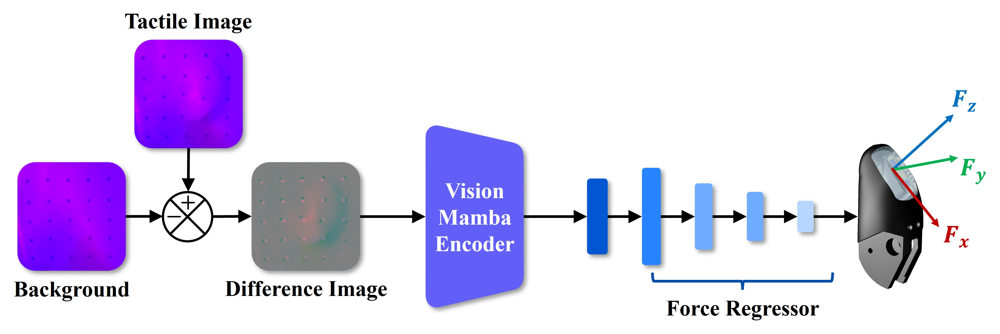
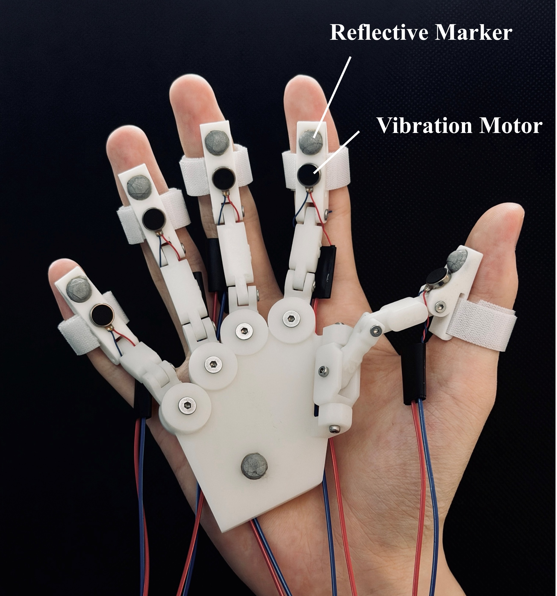

# GelFin-for-ORCA-Hand-V1
The system consists of GelFin, TacVim, and IsoPalm. GelFin is a compact visual-tactile sensor with dimensions comparable to a human fingertip. TacVim uses tactile difference images and a Vision Mamba encoder to estimate contact force. IsoPalm is an exoskeleton worn beneath the palm whose kinematic structure corresponds to that of the ORCA Hand. 

## GelFin
GelFin consists of a housing, a planar mirror, a camera with a fixed focus lens, an LED strip, a top cover, a transparent acrylic plate, and an elastomeric sensing layer carrying visual markers. The housing fixes the relative positions of the optical components. The camera observes the sensing surface through the inclined mirror, which folds the optical path and reduces the package length along the finger. The LED strip illuminates the elastomer through the acrylic plate, which also supports the sensing layer. The top cover secures the sensing stack and allows the elastomer to be replaced without disturbing the internal optical alignment. Normal and tangential loads deform the elastomer and displace the markers, producing tactile images that encode the three force components.

## TacVim
TacVim adopts an ImageNet-pretrained Vim-Tiny encoder. The normalized image is divided into nonoverlapping $16\times16$ patches, producing $N=196$ tokens with an embedding dimension of 192. Absolute positional embeddings are added, and a learnable class token is inserted at the center of the sequence:

$$
\mathbf{X}_0=\big[\mathbf{x}_1,\ldots,\mathbf{x}_{N/2},\mathbf{x}_{\mathrm{cls}},\mathbf{x}_{N/2+1},\ldots,\mathbf{x}_N\big]+\mathbf{E}_{\mathrm{pos}}.
$$

The sequence is processed by 24 bidirectional Mamba blocks, allowing the encoder to combine local marker displacement with deformation patterns distributed across the sensing surface. After removing the classification head, the class token output is used as the tactile feature:

$$
\mathbf{z}_t=f_{\boldsymbol{\phi}}\left(\bar{\mathbf{D}}_t\right),\qquad\mathbf{z}_t\in\mathbb{R}^{192}.
$$

The encoder is refined jointly with the force regressor so that its representation adapts from natural images to tactile deformation.

The tactile feature is mapped to the three force components by a multilayer perceptron with dimensions

$$
192\rightarrow512\rightarrow256\rightarrow128\rightarrow64\rightarrow3.
$$

## IsoPalm
IsoPalm is a wearable exoskeleton positioned beneath the palm and designed as a motion interface for the ORCA Hand V1. Its mechanical structure was derived from the official open source ORCA Hand assembly model and uniformly scaled by a factor of $0.66$ to accommodate a human hand. The scaled structure retains the kinematic topology and arrangement of the joint axes of the robotic hand, establishing explicit correspondences between their joints.

Hook and loop straps secure the exoskeleton links to the operator's fingers and guide their motion according to the IsoPalm kinematic structure. A reflective marker cluster on the palm defines the palm pose, while fingertip markers provide the positions of the five fingers. Miniature vibration motors mounted near the fingertips convey force information estimated by GelFin.

